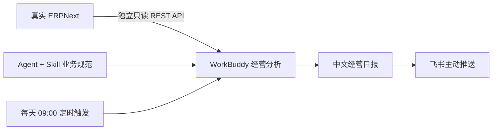
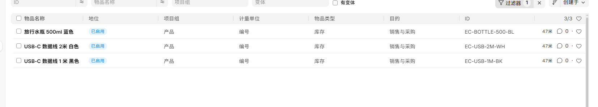
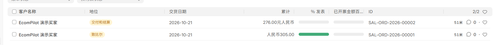
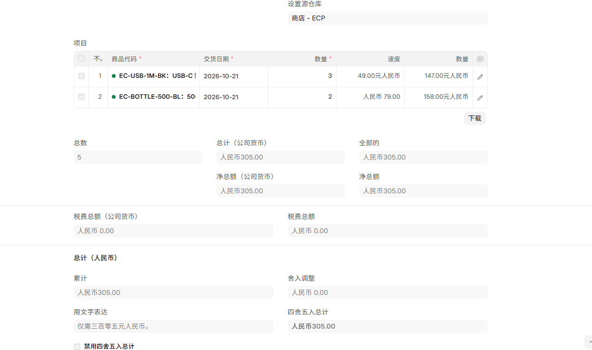
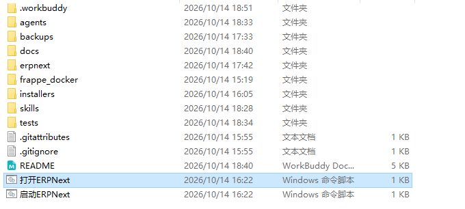
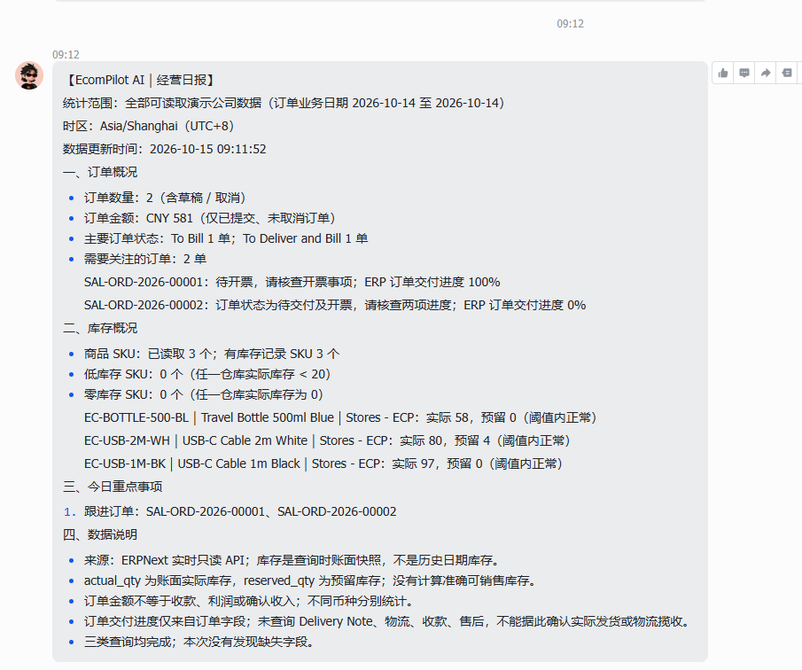

# EcomPilot AI｜跨境电商 ERP 智能经营助手

> 让真实 ERP 数据变成老板看得懂、能及时收到的经营日报。

**真实 ERPNext · 只读 API · WorkBuddy Agent + Skill · 飞书推送 · 每天 09:00 调度**

这是一个面向跨境电商运营管理的个人 AI 应用实施项目：连接真实 ERPNext，读取商品、SKU 库存与销售订单，按 WorkBuddy Agent + Skill 的业务规范统计经营情况、识别待办，生成中文日报并主动推送飞书。

## 解决什么问题

- 老板每天手动进入 ERP，逐个查看订单和库存。
- 商品、订单、仓库数据分散，需要人工汇总。
- 低库存风险和待处理订单容易遗漏。
- 整理并发送经营日报占用运营时间。

## 从数据到行动

| 核心能力 | 实现与验证 |
|---|---|
| 真实数据读取 | Item、Sales Order、Bin 三类接口已成功读取 |
| 安全访问 | 独立只读账号；未授权新增商品返回 HTTP 403 |
| 订单分析 | 按业务日期筛选，统计数量、状态与金额；不同币种分别汇总 |
| 库存预警 | 按 SKU、仓库展示实际及预留库存；默认阈值20，可调整 |
| 中文日报与飞书 | 按 Skill 规则生成报告；已有真实发送结果及收件截图 |
| 定时调度 | WorkBuddy 每天 09:00（Asia/Shanghai）任务已配置并启用；已有次日上午09:12的飞书收件截图 |

项目已交付 **1 个 Agent：`ecompilot-agent`** 与 **1 个 Skill：`erp-business-report`**。已有执行记录证明 WorkBuddy 读取了业务规范、运行 Skill 查询脚本并调用现有飞书工具；原生专家身份启动与 Skill 加载的完整调用证据仍待补齐。

## 实际展示

以下均为真实运行截图。演示商品和买家为模拟业务数据，未使用生成界面。

<strong>① ERPNext：真实商品与业务单据</strong>

3 个测试 SKU，直接管理在真实 ERPNext 商品表中。

2 张销售订单金额分别为305元与276元；列表中的交货日期不是下单业务日期。

商品 SKU、数量与金额可以追溯到 ERP 业务单据明细。

库存读取结果见下方真实日报，按 SKU、仓库列示。

<strong>② Agent + Skill：项目源文件</strong>

Agent 与 Skill 源文件已交付；此图展示源文件结构，不作为原生专家加载成功的证据。

<strong>③ 中文经营日报：已实际送达飞书</strong>

2026-10-15 上午09:12收到真实日报，报告更新时间为09:11:52；统计的是10月14日的全部演示订单，没有把历史订单冒充当天新增订单。

<strong>④ 每天 09:00：WorkBuddy 定时任务</strong>

每天09:00为计划执行时间，09:12为上图实际收件时间；任务触发及延迟原因尚未核对运行日志，不宣称准点送达。

## 演示成果

2026-10-14 的一次完整查询读到 **3 个 SKU、3 条库存记录、2 张销售订单，订单金额 CNY 581**。默认阈值20时没有低库存；仅把分析阈值改为60后，实际库存58的蓝色水瓶触发预警，ERP 库存未被修改。

已验证 **真实 ERP 读取 → 经营统计与报告 → 飞书送达** 的业务闭环，并启用每日调度。金额是销售订单金额，不是收款、利润或确认收入；库存是账面快照，不冒充准确可销售量。日报保留统计区间、更新时间与未查询业务的限制，不推测物流状态。

## 技术与实施

| 技术 | 项目中的作用 |
|---|---|
| ERPNext 16 | 商品、库存、销售订单的真实数据来源 |
| Docker Desktop / Compose | 使用官方 Frappe Docker 方案本地部署，命名卷持久保存数据 |
| REST API | 原只读账号访问经营数据；凭据保存在本机 Windows DPAPI 加密存储 |
| WorkBuddy Agent + Skill | 任务编排、业务规则与报告生成；少量 Python / PowerShell 辅助查询统计 |
| 飞书连接器 / WorkBuddy 调度 | 复用现有发送能力，配置每日09:00触发 |
| Git / Codex | 本地版本管理，以及辅助开发、部署与问题排查 |

个人实施工作包括：ERP 部署与初始化、最小读取权限排查、日期与金额口径设计、库存预警、日报生成和真实飞书发送核验。复用现有运行平台，没有另造 Agent 框架。

**项目边界：真实 ERPNext 软件 + 模拟业务数据，属于个人求职作品，不是企业生产环境。** 当前定时任务按全部演示数据统计；若用作每日新增订单日报，应切换为今日口径。本地定时运行依赖电脑、ERP 服务与 WorkBuddy 可用。未接入店铺、物流、支付或售后，也不执行采购或其他业务写入。

源文件：[Agent](agents/ecompilot-agent.md) · [Skill](skills/erp-business-report/SKILL.md) · [安装使用说明](docs/Agent安装与使用说明.md) · [验证记录](docs/ERP经营日报测试说明.md)
